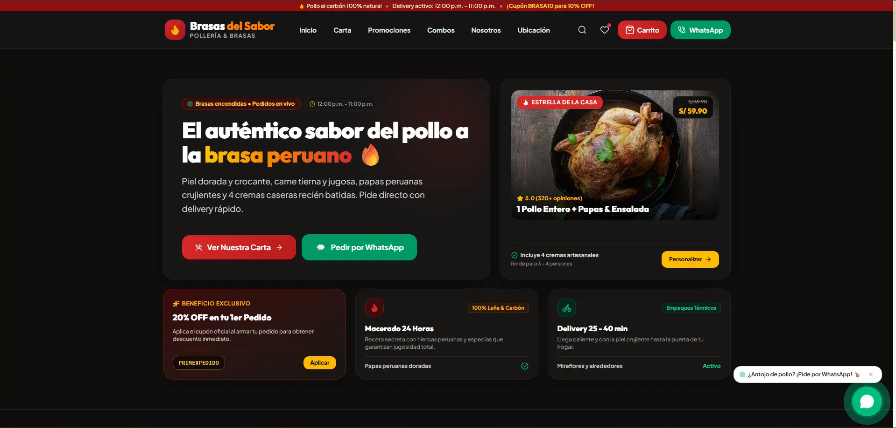
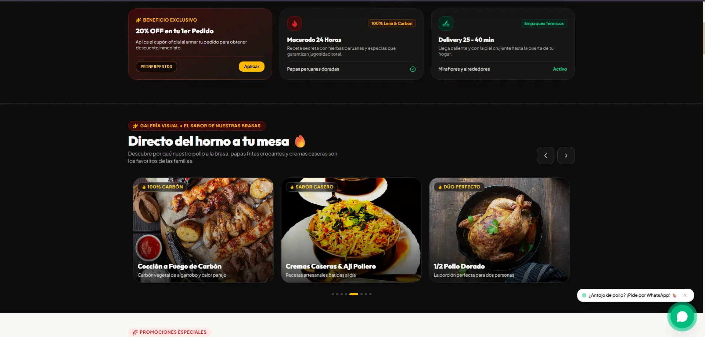
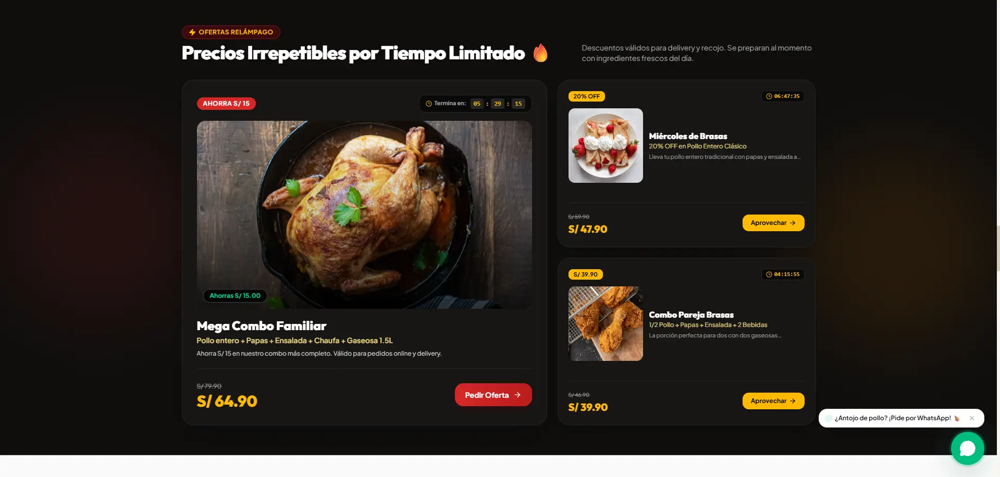
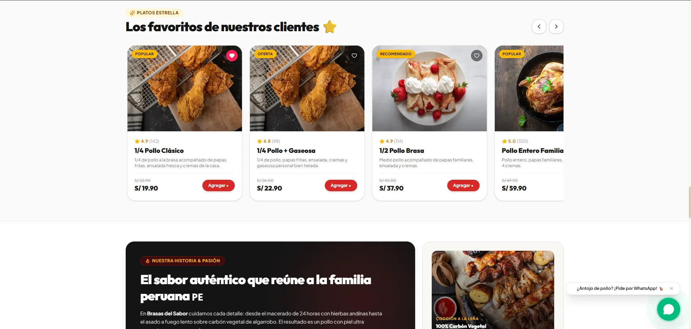
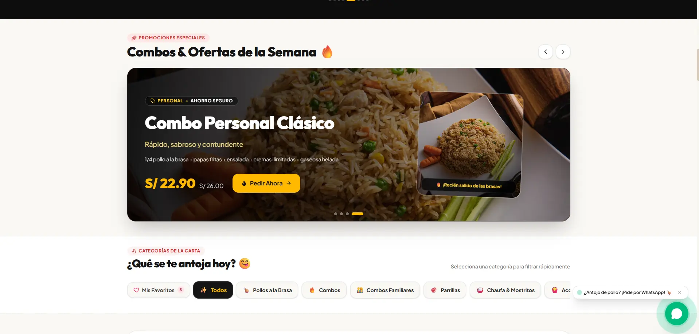
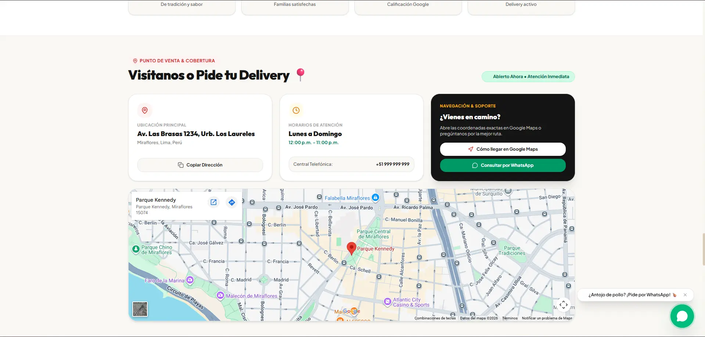

<div align="center">
  <h1>🍗 Brasas del Sabor</h1>
  <h3>Landing page gastronómica para pedidos de pollo a la brasa</h3>
  <br>
  <p>
    <a href="https://github.com/wanglingtech/LandingPage_Polleria">
      
    </a>
    <a href="https://landing-page-polleria.vercel.app/">
      
    </a>
    
    
  </p>
  <p>
    
    
    
    
  </p>
</div>

---

## 📸 Vista previa

Las siguientes imágenes muestran las principales secciones de la interfaz:

<div align="center">
  <table>
    <tr><td align="center" width="50%"><strong>🏠 Inicio</strong></td><td align="center" width="50%"><strong>🍗 Carta de productos</strong></td></tr>
    <tr><td></td><td></td></tr>
    <tr><td align="center"><strong>🖼️ Galería visual</strong></td><td align="center"><strong>⚡ Ofertas relámpago</strong></td></tr>
    <tr><td></td><td></td></tr>
    <tr><td align="center"><strong>⭐ Platos estrellas</strong></td><td align="center"><strong>🎁 Promociones especiales</strong></td></tr>
    <tr><td></td><td></td></tr>
    <tr><td align="center" colspan="2"><strong>📍 Punto de venta y cobertura</strong></td></tr>
    <tr><td colspan="2"></td></tr>
  </table>
</div>

<!-- Ejemplo usando una imagen alojada en internet:

-->

---

## 🎯 Descripción

**Brasas del Sabor** es una landing page moderna y responsive para un restaurante especializado en pollo a la brasa peruano. Reúne la presentación del negocio, carta, promociones, ubicación, reseñas y preguntas frecuentes.

El visitante puede explorar productos, filtrar por categorías, consultar detalles, marcar favoritos, agregar productos al carrito y generar un pedido o consulta mediante WhatsApp.

> **Alcance actual:** frontend demostrativo con datos locales/mock y persistencia en el navegador. Preparado para evolucionar hacia una API, inventario y pedidos reales.

## ✨ Funcionalidades

| Ícono | Funcionalidad           | Descripción                                      |
| ----- | ----------------------- | ------------------------------------------------ |
| 🏠    | **Hero principal**      | Presentación de la marca y llamadas a la acción. |
| 🍽️    | **Carta digital**       | Catálogo con categorías y búsqueda.              |
| 🔍    | **Detalle de producto** | Modal con información y productos relacionados.  |
| 🏷️    | **Promociones**         | Ofertas, descuentos y cupones configurables.     |
| 🛒    | **Carrito**             | Cantidades, delivery y total estimado.           |
| ⭐    | **Favoritos**           | Productos guardados en localStorage.             |
| 💬    | **WhatsApp**            | Acceso directo para consultas o pedidos.         |
| 📍    | **Ubicación**           | Dirección, horarios y mapa.                      |
| 📱    | **Responsive**          | Experiencia adaptada a móvil y escritorio.       |

## 🔗 Enlaces

- **Repositorio:** https://github.com/wanglingtech/LandingPage_Polleria
- **Demo pública:** https://landing-page-polleria.vercel.app/

## 🛠️ Tecnologías

- **React 19** y **TypeScript**
- **Vite 6** y **Tailwind CSS 4**
- **Lucide React** para iconos
- **Motion** para animaciones
- **Canvas Confetti** para efectos de confirmación

## 📁 Estructura del proyecto

```text
.
├── public/                  # Recursos públicos y futuras capturas
├── src/
│   ├── components/          # Secciones, catálogo, carrito y navegación
│   ├── context/             # Estado global de carrito y notificaciones
│   ├── data/                # Productos, ofertas, categorías, FAQ y reseñas
│   ├── hooks/               # Hooks reutilizables
│   ├── services/            # Servicios de productos y pedidos
│   ├── assets/              # Imágenes y recursos de la marca
│   ├── config.ts            # Datos del restaurante y cupones
│   ├── App.tsx              # Composición principal
│   └── main.tsx             # Punto de entrada
├── index.html
├── package.json
└── vite.config.ts
```

## 🚀 Instalación y ejecución

### Requisitos

- Node.js 18 o superior
- npm 9 o superior

```bash
git clone https://github.com/wanglingtech/LandingPage_Polleria.git
cd LandingPage_Polleria
npm install
npm run dev
```

Abre http://localhost:3000 en tu navegador.

## 📜 Scripts disponibles

```bash
npm run dev      # Servidor de desarrollo
npm run lint     # Comprueba TypeScript
npm run build    # Compilación de producción en dist/
npm run preview  # Previsualiza la compilación
```

## ⚙️ Configuración

Actualiza los datos del negocio en src/config.ts: nombre, teléfono, WhatsApp, dirección, mapa, horarios, delivery, redes sociales y cupones. Los productos, categorías, ofertas, reseñas y preguntas frecuentes se gestionan desde src/data/.

## 📄 Licencia

Este repositorio tiene una **licencia de uso personal y demostrativo**. No se permite el uso comercial, redistribución, reventa ni reproducción sustancial del código sin autorización previa por escrito. Consulta [LICENSE](./LICENSE) para conocer los términos completos.

## 👨‍💻 Autor

<div align="center">  <h3>WangLing Tech</h3> <p><em>Desarrollador Full-Stack</em></p> <p> <a href="https://github.com/wanglingtech">  </a> <a href="https://www.linkedin.com/in/kevin-villegas-solis-7b0038366/">  </a> <a href="mailto:kevinvillegas.dev@gmail.com">  </a> <a href="https://www.youtube.com/@xWangLingx">  </a> </p> </div>
<div align="center"> <p>Hecho con ❤️ usando TypeScript, React y dedicación para <strong>Brasas del Sabor</strong></p> <p>    </p> </div>
